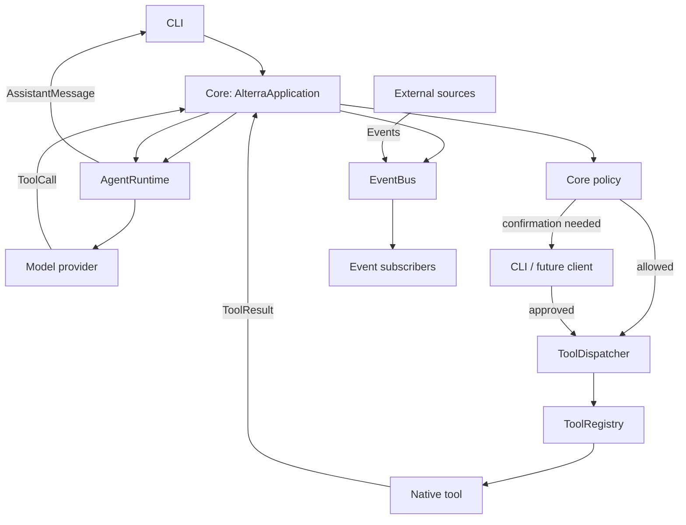

# Alterra architecture — Phase 4

## Current phase

Phase 4 adds the event subsystem and memory tools. Voice, integrations, scheduling, MCP, and
computer control are deliberately out of scope.

## Boundaries and dependency direction

`main` is the composition root. `core` owns the user-interaction lifecycle and sessions;
`agent` owns model interaction; `tools` owns definitions, validation, registration, and execution.
`events` owns the event bus and subscriptions. Tools have no model dependency. Provider-specific
code is isolated under `agent/providers`.

## Contracts

| Contract | Owner | Purpose |
| --- | --- | --- |
| `UserMessage`, `AssistantMessage`, `ToolCall`, `ToolResult` | `core` | Canonical provider-neutral messages |
| `Session` | `core` | Temporary conversation state; not long-term memory |
| `Model` / `AgentResponse` | `agent` | Replaceable reasoning provider boundary |
| `Tool` / `ToolContext` | `tools` | Capability definition and validated execution |
| `ToolRegistry` / `ToolDispatcher` | `tools` | Availability and operational execution boundary |
| `Policy`, `PolicyDecision`, `ConfirmationHandler` | `core` | Authorization outside the model |
| `MemoryStore`, `MemoryRetriever` | `memory` | Explicit retained facts and retrieval |
| `Event`, `EventSubscription` | `events` | World-to-Alterra event flow |
| `EventBus` | `events` | Async publish/subscribe with filters |

## Subsystems

### Events (Phase 4)

The event subsystem decouples external occurrences from the agent reasoning loop. It consists of:

- **Event** — Immutable record with `type`, `source`, `timestamp`, `payload`, and optional `correlation_id`
- **EventSubscription** — Binds a subscriber to an event type with optional filter
- **EventBus** — In-memory async publish/subscribe with exception isolation

Events flow from external sources (Home Assistant, scheduler, computer sensors, MCP servers)
through the bus to subscribers (core, agent, tools, future voice, UI). The agent never receives
events directly; the application decides how to translate events into user messages or internal
actions.

### Memory (Phase 3, tools added in Phase 4)

Persistent memory is distinct from temporary `Session` conversation history and current world
state. `SQLiteMemoryStore` stores only records explicitly created through its API; it never writes
conversation turns or model output automatically. Every record has content, source, scope,
confidence, creator, timestamps, and arbitrary JSON metadata. `MemoryRetriever` provides simple
case-insensitive text retrieval now; it can be replaced with a semantic implementation without
changing Core or Agent contracts.

**Memory Tools (Phase 4):**
- `memory.store` — Store a fact with scope, confidence, metadata (LOW risk)
- `memory.retrieve` — Search memories by query with scope/limit filters (NONE risk)
- `memory.delete` — Delete by ID with confirmation (MEDIUM risk, requires confirmation)

## Adding extensions

Add a simple native capability by implementing `Tool`, giving it a namespaced name and Pydantic
argument model, then registering it in the composition root. Do not modify `core/application.py`
or `agent/runtime.py`. Integrations added later belong outside `tools`; their tools should adapt
integration operations into the stable `Tool` contract.

Add an event subscriber by calling `EventBus.subscribe(event_type, handler, subscriber_id="...")`.
The handler receives `Event` objects; filters can narrow delivery.

## Policy and execution controls

Each tool declares `ToolPolicyMetadata`: an explicit risk level, a confirmation requirement, and
an execution timeout. The application resolves a tool only to inspect this metadata, evaluates
policy, obtains confirmation if required, and then delegates execution to the dispatcher. A model
cannot bypass or override any of those steps. `DefaultPolicy` supports configured denied tools,
risk overrides, and risk levels that require confirmation. The default non-interactive
confirmation handler rejects requests; the CLI provides an explicit `y`/`yes` prompt.

## Configuration and development

Environment variables use the `ALTERRA_` prefix. The default `local` model profile is offline and
supports the initial demos. Set `ALTERRA_MODEL_PROVIDER=openai` with `ALTERRA_OPENAI_API_KEY`, or
`ALTERRA_MODEL_PROVIDER=openrouter` with `ALTERRA_OPENROUTER_API_KEY`, to use an optional Responses
API adapter. OpenRouter models use their catalog-style slug through `ALTERRA_OPENROUTER_MODEL`
(for example, `openai/gpt-5`). Run `uv run pytest` and `uv run ruff check .`.

## Known limitations

The local model is intentionally deterministic and only routes the three Phase 1 tools plus the
memory tools. It is a development provider, not a general conversational model. The OpenAI adapter
translates the provider's function calls at the boundary, leaving the rest of Alterra
provider-neutral. The event bus is in-memory only; a distributed implementation would require a
separate backend.