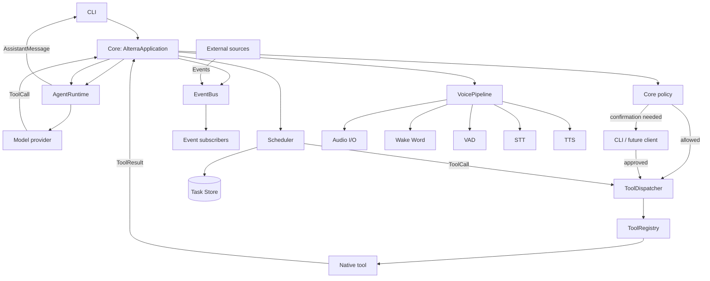

# Alterra architecture — Phase 6

## Current phase

Phase 6 adds the voice subsystem for wake word detection, voice activity detection, speech-to-text,
and text-to-speech. Integrations, MCP, and computer control are deliberately out of scope.

## Boundaries and dependency direction

`main` is the composition root. `core` owns the user-interaction lifecycle and sessions;
`agent` owns model interaction; `tools` owns definitions, validation, registration, and execution.
`events` owns the event bus and subscriptions. `scheduler` owns task scheduling and execution.
`voice` owns audio I/O, wake word, VAD, STT, and TTS abstractions. Tools have no model dependency.
Provider-specific code is isolated under `agent/providers`.

## Contracts

| Contract | Owner | Purpose |
| --- | --- | --- |
| `UserMessage`, `AssistantMessage`, `ToolCall`, `ToolResult` | `core` | Canonical provider-neutral messages |
| `Session` | `core` | Temporary conversation state; not long-term memory |
| `Model` / `AgentResponse` | `agent` | Replaceable reasoning provider boundary |
| `Tool` / `ToolContext` | `tools` | Capability definition and validated execution |
| `ToolRegistry` / `ToolDispatcher` | `tools` | Availability and operational execution boundary |
| `Policy`, `PolicyDecision`, `ConfirmationHandler` | `core` | Authorization outside the model |
| `MemoryStore`, `MemoryRetriever` | `memory` | Explicit retained facts and retrieval |
| `Event`, `EventSubscription` | `events` | World-to-Alterra event flow |
| `EventBus` | `events` | Async publish/subscribe with filters |
| `Schedule`, `TaskCreate`, `TaskRecord` | `scheduler` | Task definitions and runtime state |
| `Scheduler`, `TaskStore` | `scheduler` | Task scheduling, persistence, and execution |
| `AudioChunk`, `TranscriptionResult` | `voice` | Audio data and STT results |
| `WakeWordResult`, `VADResult` | `voice` | Wake word and VAD results |
| `WakeWordBackend`, `VADBackend` | `voice` | Replaceable wake word and VAD backends |
| `STTBackend`, `TTSBackend` | `voice` | Replaceable STT and TTS backends |
| `AudioBackend`, `AudioPlayer` | `voice` | Audio I/O abstraction |
| `VoicePipeline`, `VoiceConfig` | `voice` | Voice pipeline orchestration |

## Subsystems

### Voice (Phase 6)

The voice subsystem provides a complete audio interaction pipeline with replaceable backends:

- **AudioChunk** — Immutable audio buffer with sample rate, channels, timestamp
- **WakeWordBackend** — Detects wake words (e.g., "Alterra") from streaming audio
- **VADBackend** — Voice Activity Detection distinguishes speech from silence
- **STTBackend** — Speech-to-Text transcribes audio to text (supports streaming)
- **TTSBackend** — Text-to-Speech synthesizes text to audio (supports streaming)
- **AudioBackend** — Abstracts microphone capture and speaker playback
- **VoicePipeline** — Orchestrates the full pipeline: wake word → VAD → STT → TTS

The pipeline operates as a state machine:
1. **LISTENING_WAKE** — Waiting for wake word
2. **LISTENING_SPEECH** — Capturing speech after wake word
3. **TRANSCRIBING** — Running STT on captured audio
4. **SPEAKING** — Playing TTS response

**Voice Tools (Phase 6):**
- `voice.listen` — Start listening for voice input (LOW risk)
- `voice.speak` — Speak text using TTS (LOW risk)
- `voice.stop` — Stop the voice pipeline (NONE risk)
- `voice.status` — Get pipeline status (NONE risk)

### Scheduler (Phase 5)

The scheduler subsystem manages recurring and one-time tasks independently of the agent reasoning
loop. It consists of:

- **Schedule** — Defines when a task runs: `once` (at a specific time), `interval` (every N
  seconds), or `cron` (cron expression with timezone)
- **TaskCreate / TaskRecord** — Task definition with name, description, schedule, target tool,
  arguments, and runtime state (status, run count, next run time, errors)
- **TaskStore** — SQLite-backed persistence with indexes for due-task queries
- **Scheduler** — Async loop that wakes at a configurable interval, finds due tasks, invokes their
  tools via the dispatcher, and updates state

Tasks are created through the `scheduler.create` tool (LOW risk), cancelled with
`scheduler.cancel` (LOW risk), and listed with `scheduler.list` (NONE risk). The LLM proposes
task creation; the application policy authorizes it; the scheduler owns execution timing.

The scheduler is decoupled from the agent: the agent never waits for or directly triggers tasks.
External events (via EventBus) can trigger task creation, but task execution is owned by the
scheduler loop.

### Events (Phase 4)

The event subsystem decouples external occurrences from the agent reasoning loop. It consists of:

- **Event** — Immutable record with `type`, `source`, `timestamp`, `payload`, and optional `correlation_id`
- **EventSubscription** — Binds a subscriber to an event type with optional filter
- **EventBus** — In-memory async publish/subscribe with exception isolation

Events flow from external sources (Home Assistant, scheduler, computer sensors, MCP servers)
through the bus to subscribers (core, agent, tools, future voice, UI). The agent never receives
events directly; the application decides how to translate events into user messages or internal
actions.

### Memory (Phase 3, tools added in Phase 4)

Persistent memory is distinct from temporary `Session` conversation history and current world
state. `SQLiteMemoryStore` stores only records explicitly created through its API; it never writes
conversation turns or model output automatically. Every record has content, source, scope,
confidence, creator, timestamps, and arbitrary JSON metadata. `MemoryRetriever` provides simple
case-insensitive text retrieval now; it can be replaced with a semantic implementation without
changing Core or Agent contracts.

**Memory Tools (Phase 4):**
- `memory.store` — Store a fact with scope, confidence, metadata (LOW risk)
- `memory.retrieve` — Search memories by query with scope/limit filters (NONE risk)
- `memory.delete` — Delete by ID with confirmation (MEDIUM risk, requires confirmation)

## Adding extensions

Add a simple native capability by implementing `Tool`, giving it a namespaced name and Pydantic
argument model, then registering it in the composition root. Do not modify `core/application.py`
or `agent/runtime.py`. Integrations added later belong outside `tools`; their tools should adapt
integration operations into the stable `Tool` contract.

Add an event subscriber by calling `EventBus.subscribe(event_type, handler, subscriber_id="...")`.
The handler receives `Event` objects; filters can narrow delivery.

Add a scheduled task via `scheduler.create` tool; the scheduler loop handles execution timing.

Add a voice backend by implementing `WakeWordBackend`, `VADBackend`, `STTBackend`, `TTSBackend`,
or `AudioBackend` and registering in the composition root.

## Policy and execution controls

Each tool declares `ToolPolicyMetadata`: an explicit risk level, a confirmation requirement, and
an execution timeout. The application resolves a tool only to inspect this metadata, evaluates
policy, obtains confirmation if required, and then delegates execution to the dispatcher. A model
cannot bypass or override any of those steps. `DefaultPolicy` supports configured denied tools,
risk overrides, and risk levels that require confirmation. The default non-interactive
confirmation handler rejects requests; the CLI provides an explicit `y`/`yes` prompt.

## Configuration and development

Environment variables use the `ALTERRA_` prefix. The default `local` model profile is offline and
supports the initial demos. Set `ALTERRA_MODEL_PROVIDER=openai` with `ALTERRA_OPENAI_API_KEY`, or
`ALTERRA_MODEL_PROVIDER=openrouter` with `ALTERRA_OPENROUTER_API_KEY`, to use an optional Responses
API adapter. OpenRouter models use their catalog-style slug through `ALTERRA_OPENROUTER_MODEL`
(for example, `openai/gpt-5`). Run `uv run pytest` and `uv run ruff check .`.

## Known limitations

The local model is intentionally deterministic and only routes the Phase 1 tools plus memory,
scheduler, and voice tools. It is a development provider, not a general conversational model.
The OpenAI adapter translates the provider's function calls at the boundary, leaving the rest of
Alterra provider-neutral. The event bus and scheduler are in-memory only; distributed implementations
would require separate backends. Cron schedule support is a stub; a full cron parser is planned
for future phases. Voice real backends (faster-whisper, Piper, Silero VAD, openWakeWord) require
external model downloads and are not included in the base dependencies.