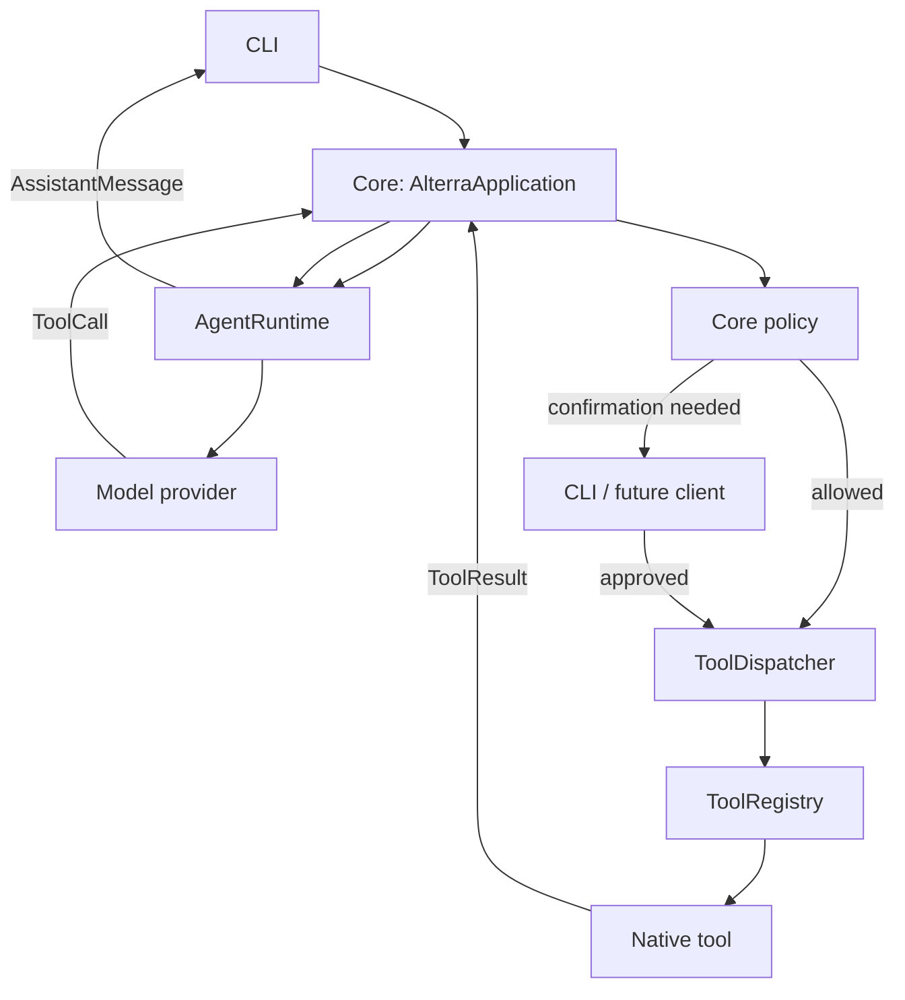

# Alterra architecture — Phase 1

## Current phase

Phase 2 adds policy, permission decisions, user confirmations, and execution timeouts to the
text-only foundation. Voice, memory, integrations, events, scheduling, MCP, and computer control
are deliberately out of scope.

## Boundaries and dependency direction

`main` is the composition root. `core` owns the user-interaction lifecycle and sessions;
`agent` owns model interaction; `tools` owns definitions, validation, registration, and execution.
Tools have no model dependency. Provider-specific code is isolated under `agent/providers`.

## Contracts

| Contract | Owner | Purpose |
| --- | --- | --- |
| `UserMessage`, `AssistantMessage`, `ToolCall`, `ToolResult` | `core` | Canonical provider-neutral messages |
| `Session` | `core` | Temporary conversation state; not long-term memory |
| `Model` / `AgentResponse` | `agent` | Replaceable reasoning provider boundary |
| `Tool` / `ToolContext` | `tools` | Capability definition and validated execution |
| `ToolRegistry` / `ToolDispatcher` | `tools` | Availability and operational execution boundary |
| `Policy`, `PolicyDecision`, `ConfirmationHandler` | `core` | Authorization outside the model |

## Adding extensions

Add a simple native capability by implementing `Tool`, giving it a namespaced name and Pydantic
argument model, then registering it in the composition root. Do not modify `core/application.py`
or `agent/runtime.py`. Integrations added later belong outside `tools`; their tools should adapt
integration operations into the stable `Tool` contract.

## Policy and execution controls

Each tool declares `ToolPolicyMetadata`: an explicit risk level, a confirmation requirement, and
an execution timeout. The application resolves a tool only to inspect this metadata, evaluates
policy, obtains confirmation if required, and then delegates execution to the dispatcher. A model
cannot bypass or override any of those steps. `DefaultPolicy` supports configured denied tools,
risk overrides, and risk levels that require confirmation. The default non-interactive
confirmation handler rejects requests; the CLI provides an explicit `y`/`yes` prompt.

## Configuration and development

Environment variables use the `ALTERRA_` prefix. The default `local` model profile is offline and
supports the Phase 1 demos. Set `ALTERRA_MODEL_PROVIDER=openai` with `ALTERRA_OPENAI_API_KEY`, or
`ALTERRA_MODEL_PROVIDER=openrouter` with `ALTERRA_OPENROUTER_API_KEY`, to use an optional Responses
API adapter. OpenRouter models use their catalog-style slug through `ALTERRA_OPENROUTER_MODEL`
(for example, `openai/gpt-5`). Run `uv run pytest` and `uv run ruff check .`.

## Known limitations

The local model is intentionally deterministic and only routes the three Phase 1 tools. It is a
development provider, not a general conversational model. The OpenAI adapter translates the
provider's function calls at the boundary, leaving the rest of Alterra provider-neutral.
